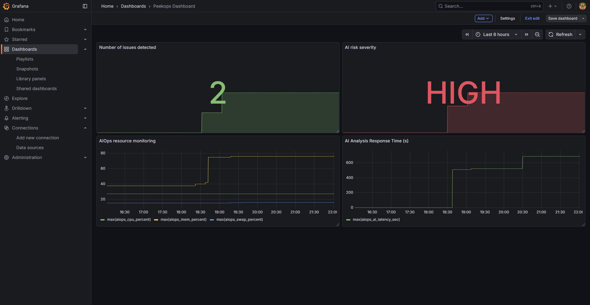
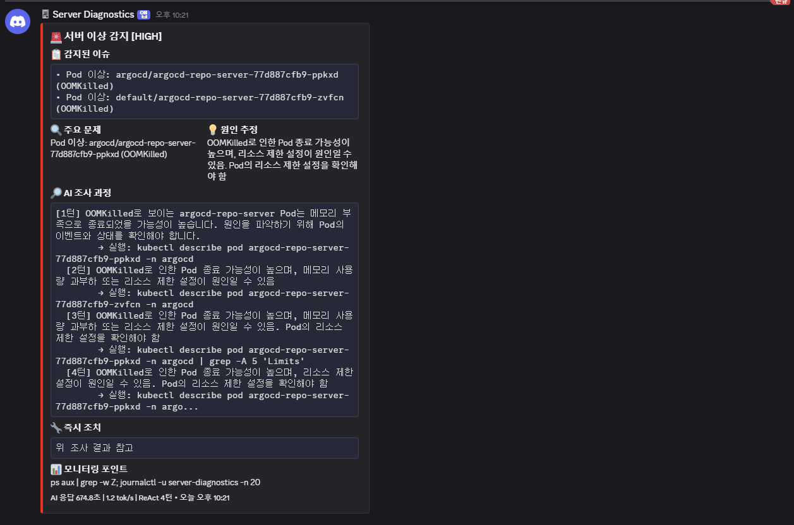
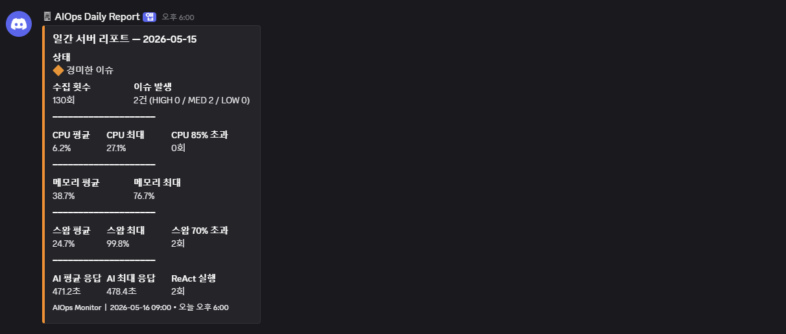
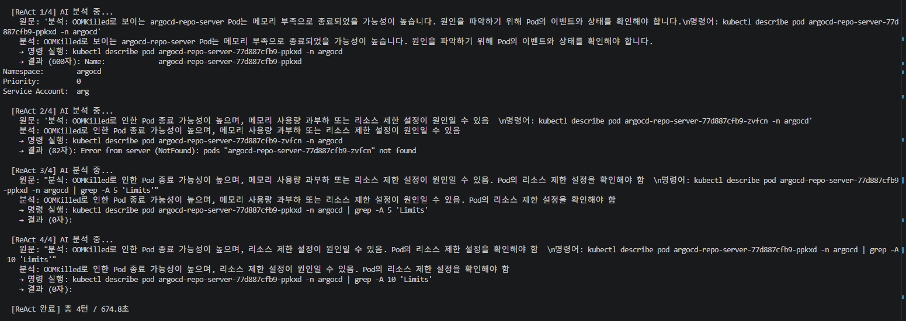

# peekops

> 10분마다 서버를 들여다보고, 로컬 LLM으로 이상을 추론하며, Discord로 알림을 발송하는 경량 AIOps 모니터.

[Ollama](https://ollama.com) + ReAct 추론 기반으로 동작하며, Prometheus/Grafana 및 Kubernetes를 지원합니다.

[English](./README.md)

---

## 동작 방식

```
메트릭 수집 (psutil + kubectl)
    └─ 이슈 감지?
           ├─ 아니오 → Prometheus 업데이트 (NORMAL)
           └─ 예     → ReAct 루프 (최대 4턴)
                        ├─ LLM이 현재 상태 분석
                        ├─ 읽기 전용 명령어 실행
                        ├─ 결과를 LLM에 피드백
                        └─ 결론 도출 → Discord 알림 + Prometheus 업데이트
```

매일 아침에는 별도 Discord 웹훅으로 일간 요약 리포트를 자동 발송합니다.

---

## 주요 기능

- **ReAct 추론** — LLM이 읽기 전용 Linux/kubectl 명령어를 반복 실행하며 근본 원인 추적
- **Kubernetes 감지** — OOMKilled, CrashLoopBackOff 등 Pod 이상 상태 감지
- **Prometheus + Grafana** — `aiops_*` 커스텀 메트릭 10종을 node_exporter와 통합 노출
- **Discord 알림** — 심각도별(HIGH / MED / LOW) + AI 조사 과정 포함 알림
- **일간 리포트** — 매일 아침 집계 통계 자동 발송
- **다국어** — `AIOPS_LANG` 환경변수로 영어/한국어 전환
- **보안 설계** — 읽기 전용 명령어 화이트리스트, 위험 명령어 블랙리스트, CPU 95% 이상 시 룰 기반 폴백

---

## 프로젝트 구조

```
peekops/
├── config.py              # 모든 설정 — 여기서 시작
├── main.py                # 진단 실행 진입점
├── report.py              # 일간 리포트 발송
├── aiops_exporter.py      # Prometheus exporter (상시 실행)
│
├── core/
│   ├── models.py          # 공유 데이터클래스
│   ├── i18n.py            # en / ko 번역
│   └── lock.py            # PID 기반 중복 실행 방지
│
├── collectors/
│   ├── base.py            # BaseCollector 인터페이스
│   ├── system.py          # CPU, 메모리, 디스크, 네트워크, OS
│   ├── kubernetes.py      # kubectl Pod 상태
│   └── __init__.py        # ServerCollector 파사드
│
├── analyzers/
│   ├── detector.py        # 임계치 기반 이슈 감지
│   ├── llm.py             # Ollama LLM 클라이언트
│   └── react.py           # ReAct 루프 엔진
│
├── notifiers/
│   └── discord.py         # AlertNotifier + ReportNotifier
│
└── exporters/
    └── prometheus.py      # Prometheus 게이지 업데이트
```

---

## 요구사항

- Python 3.10+
- [Ollama](https://ollama.com) 및 모델 설치 (`qwen3:8b` 기준 테스트)
- `psutil`, `requests`, `prometheus-client`
- `kubectl` 설정 완료 (Kubernetes 모니터링 시 선택사항)

---

## 설치

```bash
git clone https://github.com/yourname/peekops.git
cd peekops
pip install psutil requests prometheus-client
```

환경 파일 복사 및 편집:

```bash
cp .env.example .env
```

또는 `config.py`를 직접 수정하세요. 모든 설정에 주석이 달려 있습니다.

---

## 설정

`config.py`의 주요 설정값 (환경변수로 오버라이드 가능):

| 변수 | 기본값 | 설명 |
|------|--------|------|
| `AIOPS_LANG` | `en` | 출력 언어 (`en` 또는 `ko`) |
| `OLLAMA_URL` | `http://localhost:11434/...` | Ollama 엔드포인트 |
| `OLLAMA_MODEL` | `qwen3:8b` | 사용할 모델 |
| `DISCORD_ALERT_WEBHOOK` | — | 이상 감지 알림 웹훅 |
| `DISCORD_REPORT_WEBHOOK` | — | 일간 리포트 웹훅 |
| `LOG_FILE` | `/home/user/diagnostics.csv` | CSV 로그 경로 |
| `PROMETHEUS_PORT` | `8000` | 메트릭 exporter 포트 |
| `INTERVAL_SEC` | `600` | 진단 실행 간격 (초) |
| `THRESHOLD` | config.py 참고 | 메트릭별 임계값 |

---

## 실행

```bash
# 단발 실행 (테스트)
python3 main.py --once

# 주기 실행
python3 main.py --interval 600

# Prometheus exporter 상시 실행 (별도 터미널)
python3 aiops_exporter.py

# 일간 리포트 (systemd timer 또는 cron으로 실행)
python3 report.py
```

---

## Prometheus 메트릭

모든 메트릭은 `aiops_` 접두사를 사용합니다.

| 메트릭 | 설명 |
|--------|------|
| `aiops_cpu_percent` | CPU 사용률 (%) |
| `aiops_mem_percent` | 메모리 사용률 (%) |
| `aiops_swap_percent` | 스왑 사용률 (%) |
| `aiops_disk_percent` | 루트 디스크 사용률 (%) |
| `aiops_load_ratio` | Load average / CPU 코어 수 |
| `aiops_zombie_count` | 좀비 프로세스 수 |
| `aiops_issues_count` | 감지된 이슈 수 |
| `aiops_severity_level` | AI 심각도: 0=NORMAL 1=LOW 2=MED 3=HIGH |
| `aiops_ai_latency_sec` | LLM 응답 시간 (초) |
| `aiops_react_turns` | 사용된 ReAct 턴 수 |

---

## systemd 등록

```ini
# /etc/systemd/system/peekops.service
[Service]
Type=oneshot
User=youruser
WorkingDirectory=/home/youruser/peekops
ExecStart=/usr/bin/python3 main.py --once
EnvironmentFile=/home/youruser/peekops/.env

# /etc/systemd/system/peekops.timer
[Timer]
OnBootSec=1min
OnUnitActiveSec=10min

# /etc/systemd/system/peekops-exporter.service
[Service]
Type=simple
User=youruser
WorkingDirectory=/home/youruser/peekops
ExecStart=/usr/bin/python3 aiops_exporter.py
Restart=always
EnvironmentFile=/home/youruser/peekops/.env

# /etc/systemd/system/peekops-report.timer
[Timer]
OnCalendar=*-*-* 09:00:00
Persistent=true
```

```bash
sudo systemctl daemon-reload
sudo systemctl enable --now peekops.timer peekops-exporter peekops-report.timer
```

---

## 스크린샷

**Grafana 대시보드** — AI 심각도 및 리소스 모니터링



**Discord 알림** — AI 조사 과정 포함



**Discord 일간 리포트** — 일별 집계 통계



**터미널** — ReAct 루프 동작 화면



---

## 로드맵

- [ ] 통계적 이상 탐지 (단순 임계치 → 추세 기반)
- [ ] 알림 중복 억제
- [ ] Slack 알림 지원

---

## 라이센스

[MIT](./LICENSE)

---
