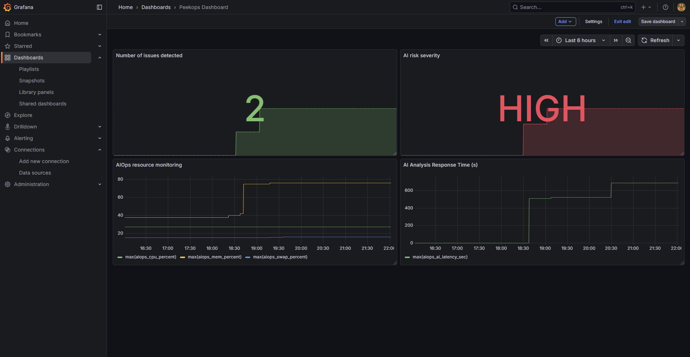
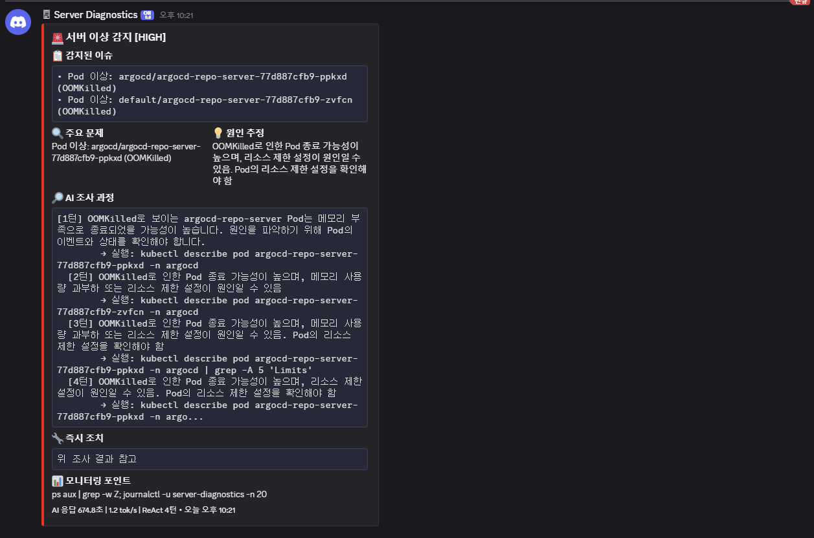
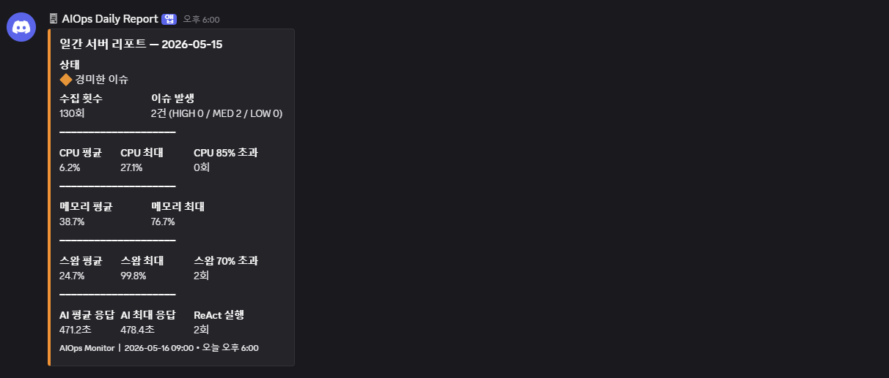
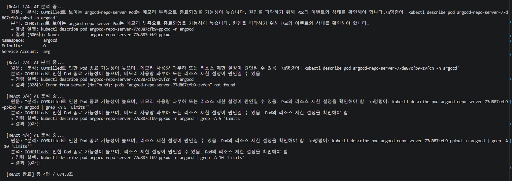

# Peekops

> A lightweight AIOps monitor that peeks into your server every 10 minutes,
> reasons through anomalies using a local LLM, and alerts you on Discord.

Built on [Ollama](https://ollama.com) + ReAct reasoning, with Prometheus/Grafana and Kubernetes support.

[한국어](./README.ko.md)

---

## How it works

```
collect metrics (psutil + kubectl)
    └─ issues detected?
           ├─ no  → update Prometheus (NORMAL)
           └─ yes → ReAct loop (up to 4 turns)
                        ├─ LLM analyzes current state
                        ├─ runs a safe read-only command
                        ├─ feeds result back to LLM
                        └─ concludes → Discord alert + Prometheus update
```

A daily summary report is also sent every morning via a separate Discord webhook.

---

## Features

- **ReAct reasoning** — LLM iteratively runs read-only Linux/kubectl commands to trace root causes
- **Kubernetes awareness** — detects OOMKilled, CrashLoopBackOff, and other pod anomalies
- **Prometheus + Grafana** — exposes 10 custom `aiops_*` metrics alongside node_exporter
- **Discord alerts** — severity-based (HIGH / MED / LOW) with AI investigation steps
- **Daily report** — aggregated stats sent every morning
- **i18n** — English and Korean output via `AIOPS_LANG` env var
- **Safety** — read-only command allowlist, dangerous command blocklist, rule-based fallback at CPU ≥ 95%

---

## Project layout

```
peekops/
├── config.py              # all settings — start here
├── main.py                # diagnostic runner
├── report.py              # daily report sender
├── aiops_exporter.py      # always-on Prometheus exporter
│
├── core/
│   ├── models.py          # shared dataclasses
│   ├── i18n.py            # en / ko translations
│   └── lock.py            # PID-based concurrency lock
│
├── collectors/
│   ├── base.py            # BaseCollector interface
│   ├── system.py          # CPU, memory, disk, network, OS
│   ├── kubernetes.py      # kubectl pod state
│   └── __init__.py        # ServerCollector facade
│
├── analyzers/
│   ├── detector.py        # threshold-based issue detection
│   ├── llm.py             # Ollama LLM client
│   └── react.py           # ReAct loop engine
│
├── notifiers/
│   └── discord.py         # AlertNotifier + ReportNotifier
│
└── exporters/
    └── prometheus.py      # Prometheus gauge updates
```

---

## Requirements

- Python 3.10+
- [Ollama](https://ollama.com) with a model pulled (tested with `qwen3:8b`)
- `psutil`, `requests`, `prometheus-client`
- `kubectl` configured (optional, for Kubernetes monitoring)

---

## Installation

```bash
git clone https://github.com/yourname/peekops.git
cd peekops
pip install psutil requests prometheus-client
```

Copy and edit the environment file:

```bash
cp .env.example .env
```

Or edit `config.py` directly — all settings are documented there.

---

## Configuration

Key settings in `config.py` (all overridable via environment variables):

| Variable | Default | Description |
|----------|---------|-------------|
| `AIOPS_LANG` | `en` | Output language (`en` or `ko`) |
| `OLLAMA_URL` | `http://localhost:11434/...` | Ollama endpoint |
| `OLLAMA_MODEL` | `qwen3:8b` | Model to use |
| `DISCORD_ALERT_WEBHOOK` | — | Webhook for incident alerts |
| `DISCORD_REPORT_WEBHOOK` | — | Webhook for daily reports |
| `LOG_FILE` | `/home/user/diagnostics.csv` | CSV log path |
| `PROMETHEUS_PORT` | `8000` | Metrics exporter port |
| `PROMETHEUS_QUERY_URL` | — | Prometheus to query for container growth; anchors issues on the container that grew most (empty = off) |
| `ANCHOR_CHANGE_WINDOW` | `30m` | Window for the growth comparison |
| `INTERVAL_SEC` | `600` | Seconds between diagnostic runs |
| `THRESHOLD` | see config.py | Per-metric alert thresholds |

---

## Usage

```bash
# single run
python3 main.py --once

# continuous loop
python3 main.py --interval 600

# always-on Prometheus exporter (run separately)
python3 aiops_exporter.py

# daily report (run via systemd timer or cron)
python3 report.py
```

---

## Prometheus metrics

All metrics are prefixed with `aiops_`.

| Metric | Description |
|--------|-------------|
| `aiops_cpu_percent` | CPU usage (%) |
| `aiops_mem_percent` | Memory usage (%) |
| `aiops_swap_percent` | Swap usage (%) |
| `aiops_disk_percent` | Root disk usage (%) |
| `aiops_load_ratio` | Load average / CPU cores |
| `aiops_zombie_count` | Zombie process count |
| `aiops_issues_count` | Issues detected per run |
| `aiops_severity_level` | AI severity: 0=NORMAL 1=LOW 2=MED 3=HIGH |
| `aiops_ai_latency_sec` | LLM response time (seconds) |
| `aiops_react_turns` | ReAct turns used |

---

## systemd setup

```ini
# /etc/systemd/system/peekops.service
[Unit]
Description=peekops diagnostic runner
After=network.target

[Service]
Type=oneshot
User=youruser
WorkingDirectory=/home/youruser/peekops
ExecStart=/usr/bin/python3 main.py --once
EnvironmentFile=/home/youruser/peekops/.env

# /etc/systemd/system/peekops.timer
[Timer]
OnBootSec=1min
OnUnitActiveSec=10min

# /etc/systemd/system/peekops-exporter.service
[Service]
Type=simple
User=youruser
WorkingDirectory=/home/youruser/peekops
ExecStart=/usr/bin/python3 aiops_exporter.py
Restart=always
EnvironmentFile=/home/youruser/peekops/.env

# /etc/systemd/system/peekops-report.service
[Service]
Type=oneshot
User=youruser
WorkingDirectory=/home/youruser/peekops
ExecStart=/usr/bin/python3 report.py
EnvironmentFile=/home/youruser/peekops/.env

# /etc/systemd/system/peekops-report.timer
[Timer]
OnCalendar=*-*-* 09:00:00
Persistent=true
```

```bash
sudo systemctl daemon-reload
sudo systemctl enable --now peekops.timer peekops-exporter peekops-report.timer
```

---

## Screenshots

## Screenshots

**Grafana Dashboard** — AI severity and resource monitoring



**Discord Alert** — ReAct investigation steps included



**Discord Daily Report** — aggregated daily stats



**Terminal** — ReAct loop in action



---

## Roadmap

- [ ] Statistical anomaly detection (beyond fixed thresholds)
- [ ] Alert deduplication
- [ ] Slack notifier

---

## License

[MIT](./LICENSE)

---
